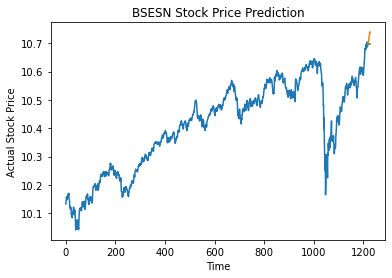
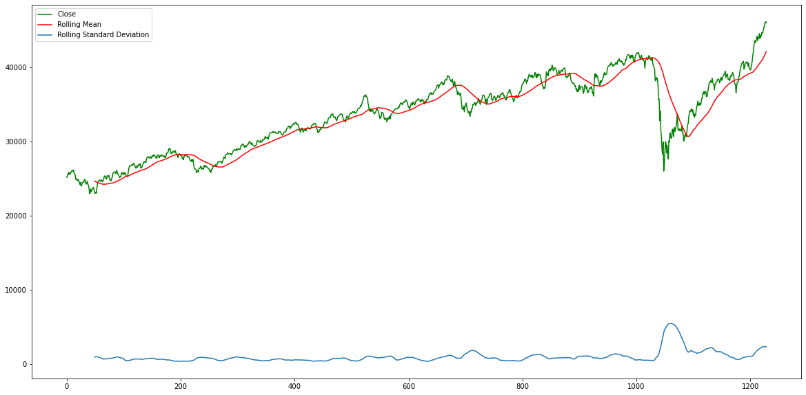
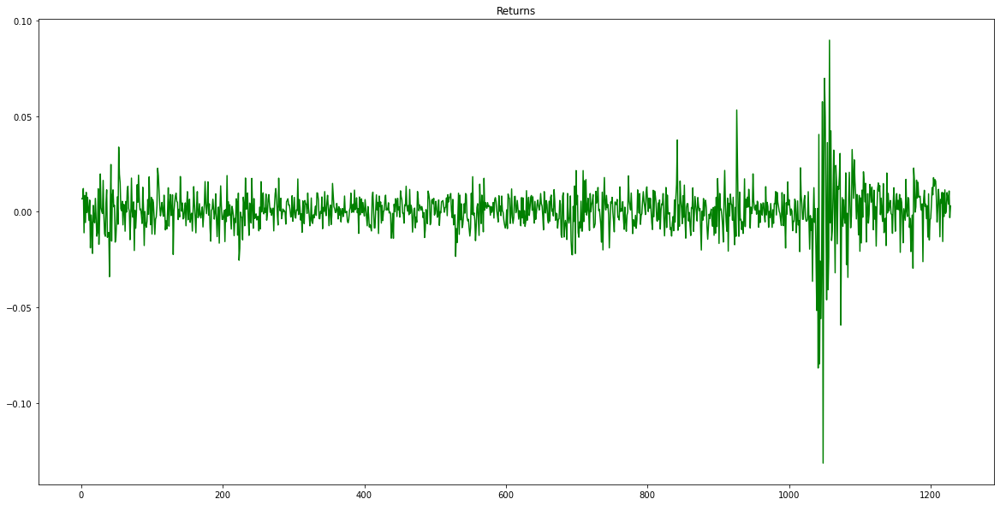

> Can daily news headlines help model a stock index? This project combines price history with headline sentiment and compares five models.

**Training project · Data Science & Business Analytics track**  
**Tools:** Python, pandas, statsmodels, pmdarima, scikit-learn, XGBoost, LightGBM, TextBlob, NLTK

## The challenge

Price history shows what happened, but not the mood behind it. The project adds a second source, the tone of daily news, to the numbers.

## The data

Daily BSE Sensex prices from Yahoo Finance (1,234 rows) and Indian news headlines (7,080 dates after grouping).

## How it works

1. Explored the BSE Sensex history, including returns, rolling averages, and stationarity.
2. Built an ARIMA baseline on the price series alone.
3. Cleaned the Indian news headlines and scored subjectivity, polarity, and sentiment.
4. Merged price and text data by date.
5. Trained and compared five regressors on the same split.

## A closer look

- **Time series:** rolling mean and deviation, stationarity checks, a log transform, then ARIMA as a baseline.
- **Text:** headlines were cleaned and scored for subjectivity, polarity, and positive, negative, neutral, and compound sentiment.
- **Models:** six features on an 80/20 split, using Random Forest, Decision Tree, AdaBoost, LightGBM, and XGBoost.

## Key decisions

- Using one split for all five regressors keeps the comparison fair.
- Sentiment scoring turns free text into numbers that a standard model can use.

## Results

| Measure | Result |
|---|---|
| Random Forest (best) · MSE | **0.0526** |
| AdaBoost · MSE | **0.0549** |
| LightGBM · MSE | **0.0583** |
| XGBoost · MSE | **0.0597** |
| Decision Tree · MSE | **0.1083** |
| ARIMA baseline · RMSE | **0.0268** |

## Visual results

*Actual index price over the study period*

*Price with moving averages*

*Daily returns: quiet periods and sudden shocks*

## Programming skills

- Python programming and reusable functions
- Time series handling with pandas
- Statistical modelling with ARIMA
- Text cleaning and sentiment analysis
- Feature engineering from two data sources
- Training and comparing regression models
- Data visualization

## Good to know

- ARIMA and the regressors use different setups, so their errors should not be compared directly.
- This is a modelling study. It was not tested as a trading strategy and is not investment advice.

## What I would do next

- Test against a simple baseline using prices only, to measure what the news adds.
- Use walk-forward validation, which respects the order of time.

<strong>بالعربي: التنبؤ بسوق الأسهم من الأسعار والأخبار</strong>

دراسة تجمع تاريخ مؤشر BSE Sensex مع تحليل مشاعر عناوين الأخبار، وتقارن خمسة نماذج. أفضلها Random Forest بخطأ 0.0526.

**ملاحظة:** ليست استراتيجية تداول مختبرة ولا نصيحة استثمارية.

**المهارات البرمجية:** Python programming and reusable functions، Time series handling with pandas، Statistical modelling with ARIMA، Text cleaning and sentiment analysis، Feature engineering from two data sources، Training and comparing regression models، Data visualization.

الكود خاص، وهذه الصفحة تعرض فكرة المشروع وطريقة عمله ونتائجه.

---

**About the source code:** the code for this project is private. This page presents what it does, how it works, and its results. To talk about the work, contact me through my [GitHub profile](https://github.com/SamerAlTaki97).
